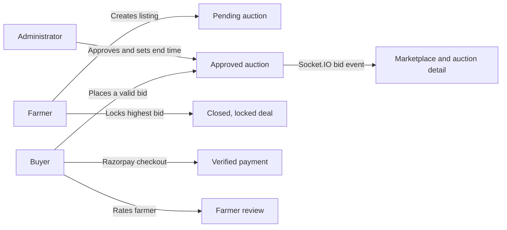
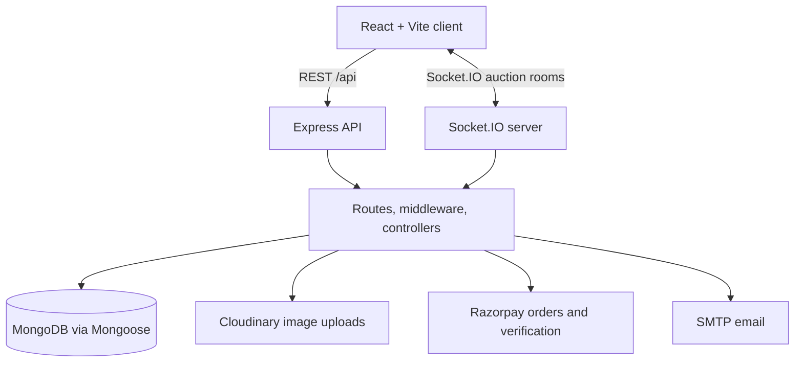

# FarmEasy

FarmEasy is a full-stack agricultural marketplace that helps farmers sell produce directly to buyers through moderated, real-time auctions. It supports the complete transaction journey: a farmer submits a listing, an administrator approves it, buyers place live bids, the farmer locks the successful deal, and the winning buyer pays through Razorpay.

The application is split into a React single-page application in [`frontend/`](frontend/) and an Express/MongoDB API in [`backend/`](backend/).

## Highlights

- Farmer, buyer, and administrator roles with server-enforced authorization
- Email-verified registration, JWT access/refresh sessions, password reset, and bcrypt password hashing
- Produce listings with category, quantity, location, availability, pricing rules, and up to five Cloudinary-hosted images
- Administrator review flow for approving, setting an auction end time, or rejecting farmer listings
- Marketplace search and filtering by text, category, state, and price range
- Atomic bid updates plus Socket.IO events for live highest-bid updates
- Farmer-controlled deal locking, winning-buyer checkout, and Razorpay signature verification
- Buyer-to-farmer ratings and reviews after a completed deal
- Personal dashboards for farmers and buyers, plus public trader profiles
- English and Hindi user-interface translations

## How it works



An approved auction is open to bids until its configured end time or until its owner locks the deal. Bids must meet the starting price (for the first bid) or exceed the current high bid by the listing's minimum increment.

## Architecture



The server creates a single HTTP server for Express and Socket.IO. Auction-detail clients join an `auction:<id>` room and receive `new-bid` and `auction-closed` events. The API uses JSON for normal requests and multipart form data only for image uploads.

## Product modules

| Module | What it provides |
| --- | --- |
| Accounts | Signup as a farmer or buyer, email verification, login/logout, token refresh, and password reset |
| Marketplace | Public approved-auction catalogue with text, category, state, and price filtering |
| Farmer workspace | Image upload, listing creation, status tracking, bid outcome visibility, and deal locking |
| Buyer workspace | Active bids, outbid listings, completed purchases, Razorpay checkout, and reviews |
| Moderation | Administrator queue for pending listings, approval/end-time setup, and rejection |
| Trust profiles | Public trading history, aggregate farmer ratings, and review history |
| Real time | Live high-bid and deal-closure updates through Socket.IO |

## Technology

| Area | Tools |
| --- | --- |
| Frontend | React 19, Vite 7, React Router 7, Redux Toolkit, Axios |
| UI | Tailwind CSS 4, Lucide React, React Toastify |
| Localization | i18next and react-i18next (English and Hindi) |
| Backend | Node.js, Express 5, Socket.IO |
| Data and security | MongoDB, Mongoose, JWT, bcrypt, Helmet, CORS, express-validator |
| Integrations | Cloudinary, Razorpay, Nodemailer/SMTP |
| Automation | Jenkins pipeline skeleton |

## Repository layout

```text
.
|-- backend/
|   `-- src/
|       |-- config/        Environment, MongoDB, Cloudinary, Razorpay setup
|       |-- controllers/   Application use cases
|       |-- middleware/    Authentication, role checks, error handling
|       |-- models/        User, Auction, Bid, Payment, Review schemas
|       |-- routes/        REST endpoint definitions
|       |-- utils/         JWT, mail, and upload helpers
|       `-- server.js      HTTP and Socket.IO bootstrap
|-- frontend/
|   `-- src/
|       |-- app/           Redux store, hooks, and client services
|       |-- components/    Layout, common, and auction UI components
|       |-- features/      Auth, auctions, bids, profiles, and admin views
|       |-- i18n/          English and Hindi translation resources
|       `-- assets/        Product imagery and landing-page video
|-- PROJECT_SUMMARY.md     Earlier project overview
|-- Jenkinsfile            Build/test/deploy pipeline stages
`-- LICENSE                MIT license
```

## Prerequisites

- Node.js and npm (use a current LTS release)
- MongoDB, local or hosted
- A Cloudinary account for listing images
- A Razorpay account for payments
- An SMTP provider for account-verification and password-reset email

## Local development

### 1. Install dependencies

Install the API and client packages separately:

```bash
cd backend
npm ci

cd ../frontend
npm ci
```

Use `npm install` instead of `npm ci` only when intentionally changing dependencies or lockfiles.

### 2. Configure the API

Create `backend/.env` from the following template. Values in angle brackets must be supplied by your environment and must never be committed.

```env
NODE_ENV=development
PORT=5000
CLIENT_URL=http://localhost:5173

MONGO_URI=mongodb+srv://<user>:<password>@<cluster>/<database>

JWT_ACCESS_SECRET=<long-random-secret>
JWT_REFRESH_SECRET=<different-long-random-secret>
# Optional; defaults are 15m and 7d
ACCESS_TOKEN_EXPIRES_IN=15m
REFRESH_TOKEN_EXPIRES_IN=7d

CLOUDINARY_CLOUD_NAME=<cloud-name>
CLOUDINARY_API_KEY=<api-key>
CLOUDINARY_API_SECRET=<api-secret>

RAZORPAY_KEY_ID=<key-id>
RAZORPAY_KEY_SECRET=<key-secret>

SMTP_HOST=<smtp-host>
SMTP_PORT=587
SMTP_USER=<smtp-user>
SMTP_PASS=<smtp-password>
```

`CLIENT_URL` must exactly match the browser client's origin. It is used for CORS, Socket.IO, and links in verification/reset emails.

### 3. Configure the client

Create `frontend/.env`:

```env
VITE_API_URL=http://localhost:5000/api
VITE_SOCKET_URL=http://localhost:5000
```

Only variables prefixed with `VITE_` are exposed to browser code. Do not place database credentials, JWT secrets, Razorpay secrets, or SMTP credentials in this file.

### 4. Start both services

Run these in separate terminals:

```bash
# terminal 1
cd backend
npm run dev
```

```bash
# terminal 2
cd frontend
npm run dev
```

Open the Vite address shown in the terminal (normally `http://localhost:5173`). Check the API with `GET http://localhost:5000/api/health`.

### Administrator access

Public signup intentionally permits only the `farmer` and `buyer` roles. To use moderation, provision an administrator directly through trusted database administration tooling by setting an existing user's `role` to `admin`. Do not expose an unauthenticated public endpoint for this operation.

## Auction and payment lifecycle

1. A verified farmer uploads up to five images and creates a listing. It begins in `PENDING` status.
2. An administrator reviews the pending listing, then approves it with an auction end time or rejects it.
3. Buyers can discover approved listings and submit a bid. The API atomically updates the high bid and emits a `new-bid` event to viewers of that auction.
4. The listing farmer may lock the highest bid, changing the listing to `CLOSED` and recording the winning buyer and amount.
5. Only that buyer can create a Razorpay order. The server verifies Razorpay's payment signature before marking the deal as paid.
6. The successful buyer can leave one 1–5 star review for the farmer. The farmer's aggregate rating is recalculated.

## API at a glance

All endpoints below are rooted at `http://<host>:<port>/api`. Protected routes accept a bearer access token and also work with the server's HTTP-only access-token cookie. Responses generally include a `success` field.

| Area | Endpoint | Access | Purpose |
| --- | --- | --- | --- |
| Health | `GET /health` | Public | Service-health response |
| Authentication | `POST /auth/signup`, `POST /auth/login`, `POST /auth/logout` | Public | Account creation and session actions |
| Authentication | `GET /auth/verify-email`, `POST /auth/forgot-password`, `POST /auth/reset-password` | Public | Email verification and password recovery |
| Authentication | `POST /auth/refresh`, `GET /auth/me` | Refresh cookie / authenticated | Renew access token or return current user |
| Auctions | `GET /auctions`, `GET /auctions/:id` | Public | Browse approved listings or view one listing |
| Auctions | `POST /auctions` | Farmer | Submit a listing for review |
| Auctions | `POST /auctions/:id/lock` | Owning farmer | Lock the current highest bid as a deal |
| Bids | `POST /:auctionId/bids` | Buyer | Place a bid on an approved auction |
| Uploads | `POST /upload` | Farmer | Upload 1–5 image files under the `images` field |
| Administration | `GET /admin/auctions/pending`, `POST /admin/auctions/:id/approve`, `POST /admin/auctions/:id/reject` | Admin | Moderate auction submissions |
| Profiles | `GET /profile/me`, `GET /profile/:userId` | Authenticated / public | Own dashboard or public profile |
| Reviews | `POST /auctions/:auctionId/review`, `GET /farmers/:farmerId/reviews` | Buyer / public | Create or read farmer feedback |
| Payments | `POST /auctions/:auctionId/payment/create-order`, `POST /payment/verify`, `GET /auctions/:auctionId/payment/status` | Authenticated | Create, verify, or view a deal payment |

The bid route is intentionally documented with its current mounted path, `POST /api/:auctionId/bids`, rather than a more conventional `/api/auctions/:auctionId/bids` path.

### Marketplace query parameters

`GET /api/auctions` accepts these optional parameters:

| Parameter | Meaning |
| --- | --- |
| `q` | Case-insensitive title or category search |
| `category` | Exact category match |
| `state` | Exact `location.state` match |
| `minPrice`, `maxPrice` | Filter on the current high bid, or the starting price when no bid exists |
| `status` | Auction status; defaults to `APPROVED` |

The endpoint returns at most 50 listings, newest first.

## Real-time events

Auction detail pages join a Socket.IO room named `auction:<auctionId>`.

| Event | Direction | Payload intent |
| --- | --- | --- |
| `join-auction` / `leave-auction` | Client → server | Subscribe or unsubscribe from an auction room |
| `new-bid` | Server → room | Updated high bid, high bidder, and the new bid summary |
| `auction-closed` | Server → room | Winning buyer, final amount, and lock time |
| `auction-approved` | Server → all connected clients | Notification that an administrator approved a listing |

## Data model

| Collection | Primary responsibility |
| --- | --- |
| `users` | Account identity, role, verification/reset tokens, and farmer-rating aggregate |
| `auctions` | Produce information, status, images, price rules, high-bid state, and locked-deal state |
| `bids` | Immutable bid records linked to an auction and buyer |
| `payments` | Razorpay order/payment identifiers, amount, participants, and payment state |
| `reviews` | One buyer review per closed auction, linked to farmer and auction |

The auction schema has `PENDING`, `APPROVED`, `LIVE`, `CLOSED`, and `REJECTED` status values. The current request flow creates `PENDING`, promotes to `APPROVED`, and closes locked deals as `CLOSED`.

## Security behavior

- Passwords are hashed with bcrypt before storage.
- Login requires email verification and issues a short-lived access JWT plus a refresh JWT; the client stores the returned access token and the API also sets HTTP-only cookies.
- Authentication middleware validates an access token, resolves the user, and applies role checks on protected operations.
- Helmet, CORS, body-size limits, request validation, and a central error handler are configured on the API.
- Image uploads accept image MIME types only, are memory-buffered, limited to 5 MB each, and are sent to Cloudinary.
- Razorpay payments are marked successful only after HMAC signature validation with the server-side Razorpay secret.

## Quality checks

```bash
# client checks
cd frontend
npm run lint
npm run build
```

The client lint and production-build commands pass in the current repository state. The Vite build currently warns that the generated JavaScript bundle and bundled media are large; consider code splitting and media optimization before a bandwidth-sensitive production rollout.

The backend currently exposes `start` and `dev` scripts only; there is no automated test or lint script yet. The checked-in Jenkinsfile contains Build, Test, and Deploy stages as placeholders; it does not currently execute project commands.

## Deployment notes

- Build the client with `npm run build` from `frontend/` and host the generated `dist/` directory on a static SPA-capable platform.
- Run the API with `npm start` from `backend/` and provide every backend environment variable through the deployment platform's secret manager.
- Set `VITE_API_URL` to the deployed API URL plus `/api`, and `VITE_SOCKET_URL` to the API origin without `/api`.
- Set `CLIENT_URL` to the exact deployed frontend origin before starting the API; the current CORS policy accepts only that configured browser origin.
- Use HTTPS in production so secure auth cookies and Razorpay checkout operate correctly.
- Do not commit `.env` files, payment credentials, SMTP passwords, JWT secrets, or MongoDB connection strings.

## Current implementation notes

This README describes the behavior present in the repository. A few points are useful to keep in mind when planning the next iteration:

- Auction closure is farmer-initiated; there is no background job that automatically changes expired approved listings to `CLOSED`.
- The client includes a bid-history component that requests `GET /api/auctions/:id/bids`, but the API does not currently expose that route.
- There are no repository tests, backend linting, CI command steps, pagination, rate limiting, or automated Cloudinary asset deletion yet.
- The source contains an `LIVE` auction-status enum value, but no current controller transitions an auction to that state.

## License

FarmEasy is licensed under the [MIT License](LICENSE).
