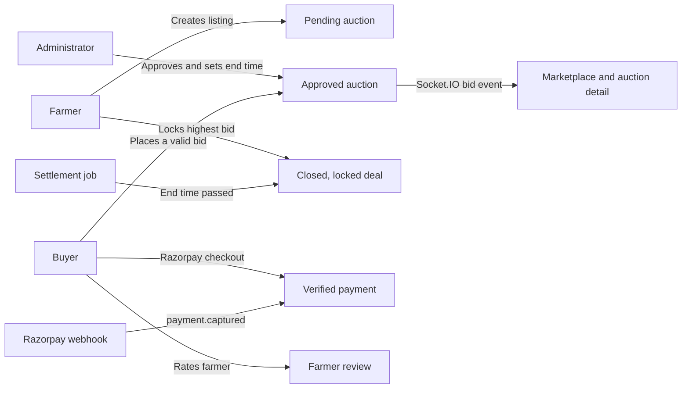
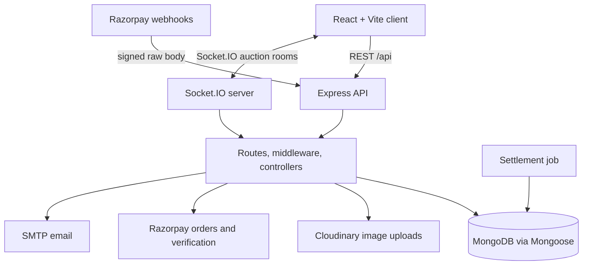

# FarmEasy

FarmEasy is a full-stack agricultural marketplace that helps farmers sell produce directly to buyers through moderated, real-time auctions. It supports the complete transaction journey: a farmer submits a listing, an administrator approves it, buyers place live bids, the farmer locks the successful deal, and the winning buyer pays through Razorpay.

The application is split into a React single-page application in [`frontend/`](frontend/) and an Express/MongoDB API in [`backend/`](backend/).

## Highlights

- Farmer, buyer, and administrator roles with server-enforced authorization
- Email-verified registration, JWT access/refresh sessions, password reset, and bcrypt password hashing
- Produce listings with category, quantity, location, availability, pricing rules, and up to five Cloudinary-hosted images
- Administrator review flow for approving, setting an auction end time, or rejecting farmer listings
- Marketplace search and filtering by text, category, state, and price range
- Bidding rules (starting price, minimum increment, end time) enforced inside a single atomic MongoDB update, with Socket.IO events for live highest-bid updates
- Farmer-controlled deal locking as a compare-and-set on the price the farmer saw, plus automatic settlement of auctions whose end time has passed
- Winning-buyer Razorpay checkout confirmed two ways: the checkout signature from the browser and a signed, idempotent Razorpay webhook
- Append-only audit trail of every auction state change, shown as an activity timeline to the farmer, winning buyer and admins
- Rate limiting on authentication, bidding and uploads
- Automated tests (Vitest, Supertest, in-memory MongoDB), including concurrency tests, run in GitHub Actions
- Buyer-to-farmer ratings and reviews after a completed deal
- Personal dashboards for farmers and buyers, plus public trader profiles
- English and Hindi user-interface translations

## How it works



An approved auction is open to bids until its configured end time (which can be no later than the produce's expiry date) or until its owner locks the deal. Bids must meet the starting price (for the first bid) or exceed the current high bid by the listing's minimum increment. When the end time passes, a background job locks the deal to the highest bidder, or closes the auction with no deal if nobody bid.

For the reasoning behind the concurrency, payment and audit design, see [`docs/ENGINEERING_NOTES.md`](docs/ENGINEERING_NOTES.md).

## Architecture



The server creates a single HTTP server for Express and Socket.IO. Auction-detail clients join an `auction:<id>` room and receive `new-bid` and `auction-closed` events. The API uses JSON for normal requests and multipart form data only for image uploads.

## Product modules

| Module | What it provides |
| --- | --- |
| Accounts | Signup as a farmer or buyer, email verification, login/logout, token refresh, and password reset |
| Marketplace | Public approved-auction catalogue with text, category, state, and price filtering |
| Farmer workspace | Image upload, listing creation, status tracking, bid outcome visibility, and deal locking |
| Buyer workspace | Active bids, outbid listings, completed purchases, Razorpay checkout, and reviews |
| Moderation | Administrator queue for pending listings, approval/end-time setup (bounded by produce expiry), and rejection |
| Audit trail | Append-only record of every auction state change, exposed as an activity timeline |
| Trust profiles | Public trading history, aggregate farmer ratings, and review history |
| Real time | Live high-bid and deal-closure updates through Socket.IO |

## Technology

| Area | Tools |
| --- | --- |
| Frontend | React 19, Vite 7, React Router 7, Redux Toolkit, Axios |
| UI | Tailwind CSS 4, Lucide React, React Toastify |
| Localization | i18next and react-i18next (English and Hindi) |
| Backend | Node.js, Express 5, Socket.IO |
| Data and security | MongoDB, Mongoose, JWT, bcrypt, Helmet, CORS, express-validator |
| Integrations | Cloudinary, Razorpay, Nodemailer/SMTP |
| Testing | Vitest, Supertest, mongodb-memory-server |
| Automation | GitHub Actions (backend tests, frontend build) |

## Repository layout

```text
.
|-- backend/
|   `-- src/
|       |-- config/        Environment, MongoDB, Cloudinary, Razorpay setup
|       |-- controllers/   Application use cases
|       |-- middleware/    Authentication, role checks, rate limits, error handling
|       |-- models/        User, Auction, Bid, Payment, Review, AuctionEvent, WebhookEvent schemas
|       |-- routes/        REST endpoint definitions
|       |-- services/      Deal locking, settlement job, payment capture, audit log
|       |-- utils/         JWT, mail, and upload helpers
|       `-- server.js      HTTP and Socket.IO bootstrap, settlement job start
|   |-- seed/              Demo data and the `npm run seed` script
|   `-- tests/             API and concurrency tests (Vitest + Supertest)
|-- frontend/
|   `-- src/
|       |-- app/           Redux store, hooks, and client services
|       |-- components/    Layout, common, and auction UI components
|       |-- features/      Auth, auctions, bids, profiles, and admin views
|       |-- i18n/          English and Hindi translation resources
|       `-- assets/        Product imagery and landing-page video
|-- docs/ENGINEERING_NOTES.md  Design decisions and trade-offs
|-- .github/workflows/     GitHub Actions CI
|-- PROJECT_SUMMARY.md     Earlier project overview
`-- LICENSE                MIT license
```

## Prerequisites

- Node.js 22.12 or newer, and npm
- MongoDB, local or hosted
- A Cloudinary account for listing images
- A Razorpay account for payments
- An SMTP provider for account-verification and password-reset email

## Local development

### 1. Install dependencies

Install the API and client packages separately:

```bash
cd backend
npm ci

cd ../frontend
npm ci
```

Use `npm install` instead of `npm ci` only when intentionally changing dependencies or lockfiles.

### 2. Configure the API

Create `backend/.env` from the following template. Values in angle brackets must be supplied by your environment and must never be committed.

```env
NODE_ENV=development
PORT=5000
CLIENT_URL=http://localhost:5173

MONGO_URI=mongodb+srv://<user>:<password>@<cluster>/<database>

JWT_ACCESS_SECRET=<long-random-secret>
JWT_REFRESH_SECRET=<different-long-random-secret>
# Optional; defaults are 15m and 7d
ACCESS_TOKEN_EXPIRES_IN=15m
REFRESH_TOKEN_EXPIRES_IN=7d

CLOUDINARY_CLOUD_NAME=<cloud-name>
CLOUDINARY_API_KEY=<api-key>
CLOUDINARY_API_SECRET=<api-secret>

RAZORPAY_KEY_ID=<key-id>
RAZORPAY_KEY_SECRET=<key-secret>
# From Razorpay Dashboard -> Webhooks (the secret you set there)
RAZORPAY_WEBHOOK_SECRET=<webhook-secret>

# Optional; how often expired auctions are settled (default 60000 ms)
SETTLEMENT_INTERVAL_MS=60000

SMTP_HOST=<smtp-host>
SMTP_PORT=587
SMTP_USER=<smtp-user>
SMTP_PASS=<smtp-password>
```

The API refuses to start if `MONGO_URI`, the JWT secrets or the Razorpay keys are missing, and warns if `RAZORPAY_WEBHOOK_SECRET` is missing.

`CLIENT_URL` must exactly match the browser client's origin. It is used for CORS, Socket.IO, and links in verification/reset emails.

### 3. Configure the client

Create `frontend/.env`:

```env
VITE_API_URL=http://localhost:5000/api
VITE_SOCKET_URL=http://localhost:5000
```

Only variables prefixed with `VITE_` are exposed to browser code. Do not place database credentials, JWT secrets, Razorpay secrets, or SMTP credentials in this file.

### 4. Start both services

Run these in separate terminals:

```bash
# terminal 1
cd backend
npm run dev
```

```bash
# terminal 2
cd frontend
npm run dev
```

Open the Vite address shown in the terminal (normally `http://localhost:5173`). Check the API with `GET http://localhost:5000/api/health`.

### Administrator access

Public signup intentionally permits only the `farmer` and `buyer` roles. To use moderation, provision an administrator directly through trusted database administration tooling by setting an existing user's `role` to `admin`. Do not expose an unauthenticated public endpoint for this operation.

### Demo data

To fill the app with realistic demo data (for a walkthrough or a recording):

```bash
cd backend
npm run seed
```

**This deletes all existing FarmEasy data** in the database named by `MONGO_URI`, then inserts 10 accounts, 12 produce listings with photos, bids, payments, reviews and a full audit trail. It asks you to type `yes` first (`npm run seed -- --yes` skips the prompt). Times are relative to when you run it, so re-run it right before a demo.

Every demo account uses the password `Demo@1234`:

| Role | Name | Email |
| --- | --- | --- |
| Admin | FarmEasy Admin | `admin@example.com` |
| Farmer | Ramesh Patel | `ramesh.farmer@example.com` |
| Farmer | Sunita Pawar | `sunita.farmer@example.com` |
| Farmer | Harpreet Singh | `harpreet.farmer@example.com` |
| Farmer | Manjunath Gowda | `manjunath.farmer@example.com` |
| Farmer | Vikram Chauhan | `vikram.farmer@example.com` |
| Buyer | Anita Traders | `anita.buyer@example.com` |
| Buyer | Kisan Fresh Foods | `kisan.buyer@example.com` |
| Buyer | Mehta Agro Exports | `mehta.buyer@example.com` |
| Buyer | GreenBasket Retail | `greenbasket.buyer@example.com` |

What the data covers:

| Scenario | Listing |
| --- | --- |
| Live bidding with history | Organic Shankar-6 cotton (4 bids), Nashik red onions, Shimla apples, Jalgaon bananas |
| First bid | Jalandhar Kufri Jyoti potatoes (no bids yet) |
| Automatic settlement, live | Fresh winter cauliflower ends 20 minutes after seeding (`--ending-soon=<minutes>` to change), then the deal locks to the top bidder |
| Automatic settlement, on startup | Byadgi green chillies ended just before seeding; the API closes it within a minute of starting |
| Admin moderation | Sharbati wheat and Sangli turmeric are `PENDING` |
| Payment | Karnal 1121 basmati rice is locked to Kisan Fresh Foods and unpaid (use Razorpay test mode) |
| Completed deals and reviews | Kolar mangoes and Kolar tomatoes, paid and reviewed (Manjunath Gowda's profile) |

Product photos come from [Unsplash](https://unsplash.com/license) (free to use). If Cloudinary is configured, the seed uploads them to your Cloudinary account once and reuses them on later runs; otherwise, or with `--no-cloudinary`, listings use the Unsplash URLs directly. The photo sources are listed in [`backend/seed/data.js`](backend/seed/data.js).

## Auction and payment lifecycle

1. A verified farmer uploads up to five images and creates a listing. It begins in `PENDING` status.
2. An administrator reviews the pending listing, then approves it (the end time defaults to, and may not be later than, the produce expiry) or rejects it. Only `PENDING` listings can be approved or rejected.
3. Buyers can discover approved listings and submit a bid. A single conditional MongoDB update checks the status, end time and minimum increment against the stored values and sets the new high bid, so concurrent bids cannot break the rules. A `new-bid` event goes to viewers of that auction.
4. The listing farmer may lock the highest bid. The request carries the amount the farmer saw; if a newer bid arrived, the API answers `409` instead of locking a different price. Otherwise the listing becomes `CLOSED` with the winning buyer and amount.
5. If the end time passes first, the settlement job locks the deal to the highest bidder (or closes the listing with no deal if there were no bids).
6. Only the winning buyer can create a Razorpay order. The deal is marked paid when either the checkout signature from the browser or Razorpay's signed `payment.captured` webhook is verified, whichever arrives first; both paths are idempotent.
7. After payment, the buyer can leave one 1–5 star review for the farmer. The farmer's aggregate rating is recalculated.

Every step above writes an event to the audit trail (`GET /api/auctions/:id/timeline`).

## API at a glance

All endpoints below are rooted at `http://<host>:<port>/api`. Protected routes accept a bearer access token and also work with the server's HTTP-only access-token cookie. Responses generally include a `success` field.

| Area | Endpoint | Access | Purpose |
| --- | --- | --- | --- |
| Health | `GET /health` | Public | Service-health response |
| Authentication | `POST /auth/signup`, `POST /auth/login`, `POST /auth/logout` | Public | Account creation and session actions |
| Authentication | `GET /auth/verify-email`, `POST /auth/forgot-password`, `POST /auth/reset-password` | Public | Email verification and password recovery |
| Authentication | `POST /auth/refresh`, `GET /auth/me` | Refresh cookie / authenticated | Renew access token or return current user |
| Auctions | `GET /auctions`, `GET /auctions/:id` | Public (pending listings: owner/admin only) | Browse listings or view one listing |
| Auctions | `GET /auctions/:id/timeline` | Owning farmer, winning buyer, admin | Audit trail of the auction |
| Auctions | `POST /auctions` | Farmer | Submit a listing for review |
| Auctions | `POST /auctions/:id/lock` | Owning farmer | Lock the current highest bid as a deal |
| Bids | `GET /auctions/:id/bids` | Public | Bid history, highest first |
| Bids | `POST /auctions/:id/bids` | Buyer | Place a bid on an approved auction |
| Uploads | `POST /upload` | Farmer | Upload 1–5 image files under the `images` field |
| Administration | `GET /admin/auctions/pending`, `POST /admin/auctions/:id/approve`, `POST /admin/auctions/:id/reject` | Admin | Moderate auction submissions |
| Profiles | `GET /profile/me`, `GET /profile/:userId` | Authenticated / public | Own dashboard or public profile |
| Reviews | `POST /auctions/:auctionId/review`, `GET /farmers/:farmerId/reviews` | Buyer / public | Create or read farmer feedback |
| Payments | `POST /auctions/:auctionId/payment/create-order`, `POST /payment/verify`, `GET /auctions/:auctionId/payment/status` | Authenticated | Create, verify, or view a deal payment |
| Payments | `POST /payment/webhook` | Razorpay (HMAC signature) | Server-to-server payment events |

### Marketplace query parameters

`GET /api/auctions` accepts these optional parameters:

| Parameter | Meaning |
| --- | --- |
| `q` | Case-insensitive title or category search (treated as literal text, max 100 characters) |
| `category` | Exact category match |
| `state` | Exact `location.state` match |
| `minPrice`, `maxPrice` | Filter on the current high bid, or the starting price when no bid exists |
| `status` | `APPROVED` (default) or `CLOSED`; other values are ignored |

The endpoint returns at most 50 listings, newest first.

## Real-time events

Auction detail pages join a Socket.IO room named `auction:<auctionId>`.

| Event | Direction | Payload intent |
| --- | --- | --- |
| `join-auction` / `leave-auction` | Client → server | Subscribe or unsubscribe from an auction room |
| `new-bid` | Server → room | Updated high bid, high bidder, and the new bid summary |
| `auction-closed` | Server → room | Winning buyer, final amount, and lock time (from a farmer lock or automatic settlement) |
| `auction-approved` | Server → all connected clients | Notification that an administrator approved a listing |

## Data model

| Collection | Primary responsibility |
| --- | --- |
| `users` | Account identity, role, verification/reset tokens, and farmer-rating aggregate |
| `auctions` | Produce information, status, images, price rules, high-bid state, and locked-deal state |
| `bids` | Immutable bid records linked to an auction and buyer |
| `payments` | Razorpay order/payment identifiers, amount, participants, and payment state |
| `reviews` | One buyer review per paid deal, linked to farmer and auction |
| `auctionevents` | Append-only audit trail: one record per auction state change |
| `webhookevents` | Razorpay webhook deliveries already seen, keyed by event id (deduplication) |

The auction schema has `PENDING`, `APPROVED`, `LIVE`, `CLOSED`, and `REJECTED` status values. The current request flow creates `PENDING`, promotes it to `APPROVED` (or `REJECTED`), and moves it to `CLOSED` when the farmer locks the deal or the end time passes. A `CLOSED` auction with `lockedDeal.isLocked: false` ended without bids.

## Security behavior

- Passwords are hashed with bcrypt before storage.
- Login requires email verification and issues a short-lived access JWT plus a refresh JWT; the client stores the returned access token and the API also sets HTTP-only cookies.
- Authentication middleware validates an access token, resolves the user, and applies role checks on protected operations.
- Helmet, CORS, body-size limits, request validation, and a central error handler are configured on the API.
- Image uploads accept image MIME types only, are memory-buffered, limited to 5 MB each, and are sent to Cloudinary.
- Razorpay payments are marked successful only after HMAC-SHA256 signature validation (constant-time comparison): the checkout signature with the key secret, or the webhook signature over the raw request body with the webhook secret. The amount must match the deal.
- Rate limits: 10 requests per 15 minutes per IP on login, signup and password reset; 30 bids per minute per user; 30 uploads per hour per user.
- Listing images must be URLs on the project's own Cloudinary account; user names are HTML-escaped in emails; search text is regex-escaped.
- Pending and rejected listings are visible only to their farmer and admins.

## Tests and quality checks

```bash
# API tests (starts a throwaway in-memory MongoDB; downloads a mongod binary on first run)
cd backend
npm test

# client build
cd ../frontend
npm run build
```

The backend suite covers the bidding rules under concurrency (50 simultaneous bids; two bids ₹1 apart arriving together), the lock-versus-bid race, admin scheduling rules, the Razorpay webhook (forged signatures, duplicate deliveries, amount mismatch, late failures) and checkout verification, automatic settlement (including two servers settling at once), the audit trail of a full deal, and general API behaviour.

GitHub Actions runs the backend tests and the frontend build on every push and pull request.

`npm run lint` in `frontend/` still reports some pre-existing issues in files not touched by the hardening work. The Vite build warns that the JavaScript bundle and bundled media are large; consider code splitting and media optimization before a bandwidth-sensitive production rollout.

## Deployment notes

- Build the client with `npm run build` from `frontend/` and host the generated `dist/` directory on a static SPA-capable platform.
- Run the API with `npm start` from `backend/` and provide every backend environment variable through the deployment platform's secret manager.
- Set `VITE_API_URL` to the deployed API URL plus `/api`, and `VITE_SOCKET_URL` to the API origin without `/api`.
- Set `CLIENT_URL` to the exact deployed frontend origin before starting the API; the current CORS policy accepts only that configured browser origin.
- Use HTTPS in production so secure auth cookies and Razorpay checkout operate correctly.
- In the Razorpay Dashboard, add a webhook pointing at `https://<api-host>/api/payment/webhook` for the `payment.captured`, `order.paid` and `payment.failed` events, and put its secret in `RAZORPAY_WEBHOOK_SECRET`. For local testing, expose the API with a tunnel such as ngrok.
- The settlement job runs inside the API process. Running several API instances is safe: each auction is closed by a conditional update, so only one instance succeeds.
- Do not commit `.env` files, payment credentials, SMTP passwords, JWT secrets, or MongoDB connection strings.

## Current implementation notes

This README describes the behavior present in the repository. A few points are useful to keep in mind when planning the next iteration:

- Bid history rows are written right after the winning auction update, not in the same transaction (see the engineering notes); the auction document is the source of truth for the highest bid.
- Audit-trail writes are best-effort: a failed audit insert is logged but never fails the user's request.
- Settlement runs on a timer, so an auction can stay open for up to one interval (60 seconds by default) after its end time; no bid is accepted after the end time.
- There is no backend linting, pagination, or automated Cloudinary asset deletion yet, and refresh tokens are not rotated or revocable.
- The source contains an `LIVE` auction-status enum value, but no current controller transitions an auction to that state.

## License

FarmEasy is licensed under the [MIT License](LICENSE).
